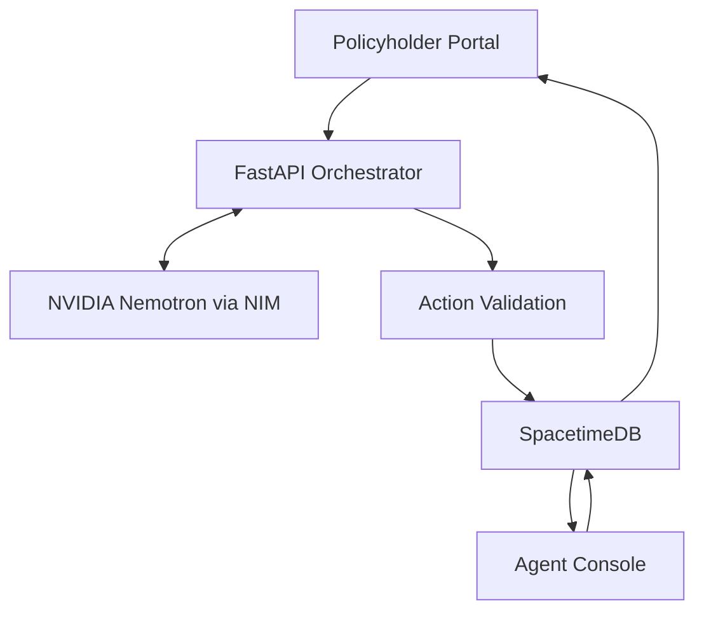

# HeyNeighbor

**We'll call you before you have to call us. We knock first.**

HeyNeighbor is a proactive disaster-response assistant built for HackUTD 2026. It uses an AI assistant named Nora to contact policyholders during emergencies, check on their safety, provide guidance, gather property-damage information, and prepare insurance claims.

The project combines NVIDIA Nemotron for conversational reasoning, FastAPI for backend orchestration, and SpacetimeDB for shared, real-time application state.

## Overview

HeyNeighbor has two main interfaces:

- **Policyholder Portal (`/customer`):** A simulated phone-call experience where users can speak with Nora, receive safety guidance, provide damage information, and track their claims.
- **Agent Console (`/agent`):** A dashboard where human agents can monitor calls, review policyholder risk, intervene in conversations, and approve claims.

The application follows a human-in-the-loop workflow. Nora gathers information and prepares claims, but a human agent reviews and approves claims before they are finalized.

## Features

### Policyholder Portal

- Simulated incoming calls with browser-based voice interaction.
- AI-generated conversations in English and Spanish.
- Live captions and conversation transcripts.
- Keypad controls for transferring to an agent, replaying responses, and changing languages.
- Claim preparation using available policyholder information.
- Verbal confirmation before claim submission.
- Emergency contact notifications with permission.
- In-app messaging and claim status tracking.
- Accessibility settings, including larger text, high contrast, and simplified language.

### Agent Console

- Risk-prioritized policyholder queue.
- Interactive map displaying simulated policyholder locations across the Dallas–Fort Worth area.
- Live call transcripts and Nora's actions.
- Ability for agents to join active calls and take over conversations.
- Claim review, editing, and approval workflows.
- Access to policyholder information, risk breakdowns, and claim details.
- Keyboard shortcuts for common agent actions.
- Optional live Nora activity feed.

## Architecture

HeyNeighbor uses four main components:

| Component | Responsibility |
|---|---|
| Next.js / React | Policyholder portal, simulated phone interface, and agent console |
| FastAPI | Conversation orchestration, session management, action validation, and backend operations |
| NVIDIA Nemotron | Conversational reasoning and structured action generation |
| SpacetimeDB | Shared application state and real-time synchronization |

### Application Flow



### Frontend

The frontend is built with Next.js, React, and TypeScript.

It contains the policyholder portal, browser-based phone interface, claim form, and agent console. The frontend handles user interaction, speech recognition, text-to-speech, captions, and displaying application state.

Conversation messages and user actions are sent to FastAPI for processing. The frontend does not independently determine Nora's conversational decisions.

### Backend

FastAPI acts as the central orchestrator between the frontend, Nemotron, and SpacetimeDB.

It is responsible for:

- Starting and managing call sessions.
- Maintaining conversation history.
- Sending caller messages and relevant context to Nemotron.
- Processing model-generated responses and actions.
- Validating requested actions before executing them.
- Updating transcripts, triage information, and claims.
- Handling agent interventions and claim approvals.

The backend also handles agent actions, allowing changes made through the console to update shared application state.

## AI Implementation

Nora uses NVIDIA Nemotron through NVIDIA NIM.

**Primary model:** `nvidia/llama-3.1-nemotron-70b-instruct`

The model receives conversation history along with relevant policyholder and claim information. It generates two outputs in a single inference pass:

1. A conversational response for Nora to communicate to the caller.
2. Structured JSON containing application actions and suggested replies.

Available actions include:

| Action | Purpose |
|---|---|
| `open_claim` | Opens or prepares a claim |
| `update_risk` | Updates a policyholder's risk information |
| `confirm_details` | Records confirmed claim information |
| `notify_emergency_contact` | Requests an emergency contact notification |
| `text_caller` | Sends a message to the policyholder |
| `submit_claim` | Initiates the claim submission workflow |
| `transfer_to_agent` | Transfers the conversation to a human agent |
| `set_language` | Changes the conversation language |
| `end_call` | Ends the active call |

The backend parses the model response, extracts the structured output, and validates requested actions before carrying them out. Response handling also accounts for reasoning tokens and Markdown formatting that may appear around JSON output.

The primary model is configured through backend environment variables. The backend also contains a fallback sequence for alternative available models.

### Consent and Claim Approval

Claim processing uses separate customer-consent and agent-approval steps.

1. Nora gathers the policyholder's damage information.
2. A claim draft is created or updated.
3. Nora asks the policyholder for explicit verbal consent.
4. The backend records the customer's approval.
5. The claim enters the agent review queue.
6. A human agent reviews and approves the claim.
7. The shared application state and customer-facing claim timeline are updated.

Nora does not independently determine insurance coverage. Coverage decisions and final claim approval remain with human agents.

### Failure Handling

If Nemotron is not configured or cannot respond, the backend returns an error and the interface indicates that Nora is unavailable. The application does not replace unavailable model responses with canned conversational answers.

## SpacetimeDB

SpacetimeDB serves as the shared source of truth for the application. It stores information used by both the policyholder portal and agent console and synchronizes updates as they occur.

For example, when Nora updates a call transcript or creates a claim:

1. FastAPI processes the event.
2. The appropriate SpacetimeDB reducer updates the database.
3. Connected clients receive the updated state through real-time subscriptions.
4. The agent console and policyholder portal reflect the changes without requiring a manual refresh.

Agent actions, such as editing or approving a claim, follow the same process. This keeps the customer-facing interface and agent dashboard synchronized.

### Database Tables

| Table | Purpose |
|---|---|
| `customers` | Policyholder profiles, contact information, and vulnerability details |
| `policies` | Policy numbers, types, deductibles, and coverage limits |
| `active_calls` | Active call sessions, transcripts, and call status |
| `triage_queue` | Risk scores, hazard classifications, and prioritization information |
| `claims` | Claim descriptions, estimates, customer consent, and agent approval status |

### Reducers

The SpacetimeDB module uses reducers to handle application state changes.

Important reducers include:

- `init_simulation`
- `update_call_transcript`
- `update_triage_score`
- `create_or_update_claim`
- `agent_approve_claim`
- `join_call_by_agent`
- `end_call`

TypeScript bindings generated from the SpacetimeDB module are located in `src/module_bindings/`.

## Risk Prioritization

HeyNeighbor uses a configurable weighted scoring model to prioritize households based on environmental conditions, vulnerability, property risk, and historical information.

\[
S = \min(100,\; w_E E + w_V V + w_P P + w_H H)
\]

The vulnerability component is calculated as:

\[
V = 0.5\left(\frac{A}{100}\right) + 0.3L + 0.2F
\]

Where:

- \(E\): Environmental risk
- \(V\): Household vulnerability
- \(P\): Property risk
- \(H\): Historical risk
- \(A\): Age
- \(L\): Whether the policyholder lives alone
- \(F\): Communication or technology barriers

The resulting score helps organize the agent's queue by relative priority. This is prototype scoring logic, not a validated emergency-response standard.

## Tech Stack

| Category | Technologies |
|---|---|
| Frontend | Next.js 16, React 19, TypeScript |
| Styling | Tailwind CSS v4 |
| Animation | Framer Motion |
| Mapping | Leaflet, React Leaflet |
| Icons | Lucide React |
| Backend | Python, FastAPI |
| AI | NVIDIA Nemotron, NVIDIA NIM |
| AI Client | OpenAI-compatible API client |
| Database | SpacetimeDB |
| Voice | Web Speech API, Web Audio API |

## Design System

HeyNeighbor uses two distinct visual styles to support the different needs of policyholders and insurance agents. The customer experience is designed to feel approachable and accessible, while the agent console prioritizes information density, readability, and efficient workflows.

### Policyholder Experience

The policyholder portal uses a warm, light interface with soft blush tones and State Farm red for primary actions.

Design priorities include:

- Large, readable typography and clear visual hierarchy.
- A familiar phone interface for simulated incoming calls.
- Simple navigation and straightforward claim information.
- Accessible controls for text size, contrast, and simplified language.
- Minimal visual clutter to keep important safety information easy to find.

### Agent Experience

The agent console uses a darker, neutral interface designed for extended desktop use.

Design priorities include:

- Dense but organized information layouts.
- Clear visual separation between the call queue, map, transcripts, and claim details.
- Color used primarily to communicate urgency, status, and warnings.
- Persistent access to important policyholder and call information.
- Efficient workflows for joining calls, editing claims, and approving submissions.

### Visual Language

| Element | Design choice |
|---|---|
| Primary accent | State Farm red (`#E61A21`) |
| Customer background | Off-white and warm light tones |
| Agent background | Dark neutral tones |
| Typography | Source Sans 3 |
| Wordmark | Bold italic styling |
| Logo | Red shield and house mark |
| Interaction style | Clear states, visible focus, and direct actions |

The design uses consistent spacing, readable typography, and clear component states across both interfaces while allowing each experience to serve its own audience.

### Color Contrast

The following are measured contrast ratios from the design:

| Color combination | Contrast ratio |
|---|---:|
| Primary portal red (`#E61A21`) on white | 4.6:1 |
| Body text (`#474954`) on white | 8.9:1 |
| Console secondary text (`#C5C9D0`) | 9.6:1 |
| Urgent indicator (`#EF8E87`) | 6.7:1+ |
| Informational indicator (`#A8C4D6`) | 8.7:1+ |
| Caution indicator (`#DDBB72`) | 8.6:1+ |

Color is not the only indicator of status; labels and other visual cues are also used to communicate information.

## Getting Started

### Requirements

- Node.js 20 or later
- Python 3.9 or later
- NVIDIA NIM API key
- SpacetimeDB configuration for database-backed functionality

The frontend and backend run separately. Use two terminal windows.

### 1. Clone the Repository

```bash
git clone https://github.com/atalvarez77/hackutd2026.git
cd hackutd2026
```

### 2. Set Up the Backend

```bash
cd backend
python -m pip install -r requirements.txt
```

Create a `.env` file inside the `backend/` directory:

```env
NVIDIA_API_KEY=nvapi-your-key
```

The following variables can also be configured:

```env
NVIDIA_MODEL=nvidia/llama-3.1-nemotron-70b-instruct
NVIDIA_BASE_URL=https://integrate.api.nvidia.com/v1

SPACETIMEDB_URI=https://maincloud.spacetimedb.com
SPACETIMEDB_DB=your-database-id
```

The NVIDIA API key is required for Nora's AI conversations. SpacetimeDB settings are needed for the shared database functionality.

Start the backend:

```bash
python -m uvicorn main:app --reload --port 8000
```

Check the backend health endpoint:

`http://localhost:8000/api/health`

### 3. Set Up the Frontend

Return to the project root and install the dependencies:

```bash
npm install
```

Create a `.env.local` file in the project root:

```env
NEXT_PUBLIC_ORCHESTRATOR_URL=http://localhost:8000

NEXT_PUBLIC_SPACETIME_URI=wss://maincloud.spacetimedb.com
NEXT_PUBLIC_SPACETIME_DB=your-database-id

NEXT_PUBLIC_SPACETIME=on
NEXT_PUBLIC_LIVE_FEED=off
```

Replace the database value with the appropriate SpacetimeDB database ID.

Configuration options:

| Variable | Default | Purpose |
|---|---|---|
| `NEXT_PUBLIC_ORCHESTRATOR_URL` | `http://localhost:8000` | FastAPI backend address |
| `NEXT_PUBLIC_SPACETIME_URI` | `wss://maincloud.spacetimedb.com` | SpacetimeDB connection address |
| `NEXT_PUBLIC_SPACETIME_DB` | Team database ID | SpacetimeDB database |
| `NEXT_PUBLIC_SPACETIME` | `on` | Set to `off` to disable SpacetimeDB integration |
| `NEXT_PUBLIC_LIVE_FEED` | `off` | Set to `true` to display the Live Nora feed |

When SpacetimeDB is disabled, synchronization is limited to the same browser rather than shared across connected clients.

### 4. Run the Frontend

From the project root:

```bash
npm run dev
```

Open the application at:

- Home: `http://localhost:3000`
- Policyholder portal: `http://localhost:3000/customer`
- Agent console: `http://localhost:3000/agent`

For testing, open the customer portal and agent console in separate browser tabs.

## API Reference

The FastAPI backend exposes the following endpoints:

| Method | Endpoint | Purpose |
|---|---|---|
| `GET` | `/api/health` | Checks backend and Nemotron availability |
| `POST` | `/api/call/start` | Starts a call session |
| `POST` | `/api/chat` | Processes a caller message, keypad input, or event |
| `POST` | `/api/transcript` | Records transcript entries |
| `POST` | `/api/call/join` | Allows an agent to join an active call |
| `POST` | `/api/call/end` | Ends an active call |
| `POST` | `/api/triage` | Updates triage information |
| `POST` | `/api/claim` | Creates or updates claim information |
| `POST` | `/api/claim/approve` | Handles agent claim approval |

## Project Structure

```text
hackutd2026/
│
├── backend/
│   ├── main.py
│   ├── conversation.py
│   ├── nemotron_service.py
│   └── requirements.txt
│
├── statefarm-backend/
│   └── spacetimedb/
│       └── src/
│           └── lib.rs
│
├── public/
│
├── src/
│   ├── app/
│   │   ├── (policyholder)/
│   │   ├── (agent)/
│   │   └── api/
│   │
│   ├── components/
│   │   ├── portal/
│   │   ├── agent/
│   │   └── ui/
│   │
│   ├── context/
│   │   └── StateFarmContext.tsx
│   │
│   ├── data/
│   │   └── mockCustomers.ts
│   │
│   ├── lib/
│   │   ├── backend.ts
│   │   ├── reader.ts
│   │   ├── voice.ts
│   │   └── i18n.ts
│   │
│   └── module_bindings/
│
├── .gitignore
├── package.json
├── package-lock.json
├── tsconfig.json
└── README.md
```

## Accessibility

Accessibility features are incorporated into the policyholder experience:

- Voice-first interaction with live captions.
- English and Spanish language support.
- Larger text, high contrast, and simplified language settings.
- Screen-reader announcements for status changes.
- Visible keyboard focus and labeled form fields.
- Touch targets of at least 44 pixels.
- Reduced-motion support.

The agent console is primarily designed for desktop use.

## Known Limitations

HeyNeighbor is a hackathon prototype, not a production insurance platform.

- Policyholder profiles, policies, claims, and geographic locations use simulated data.
- Phone calls are simulated through the browser rather than a production telephony service.
- SMS and messaging are demonstrated within the application rather than through a production messaging provider.
- The project has not been fully validated end to end with live NVIDIA NIM credentials and a live SpacetimeDB deployment.
- FastAPI call history is stored in memory and is lost when the backend restarts.
- Browser voice capabilities depend on browser support; Chrome and Edge are recommended.
- The agent console is desktop-oriented and currently English-only.
- Agent edits do not currently update Nora's existing in-memory claim context.
- The prototype risk model has not been validated for real-world emergency decisions.

A production implementation would require secure telephony and messaging integrations, authorized insurance policy and claims access, persistent session storage, validated risk models, and additional privacy, security, and reliability testing.

## Future Improvements

- Integration with real-time disaster alerts and geographic risk data.
- Production telephony and SMS integration.
- Authorized insurance policy and claims system integration.
- Persistent conversation history and improved agent handoff.
- Expanded mobile support and additional accessibility testing.
- Further validation of risk prioritization and multilingual interactions.

---

**Built at HackUTD 2026** · State Farm · NVIDIA · SpacetimeDB
